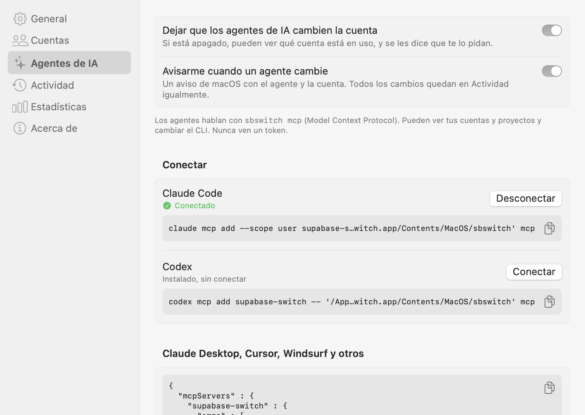
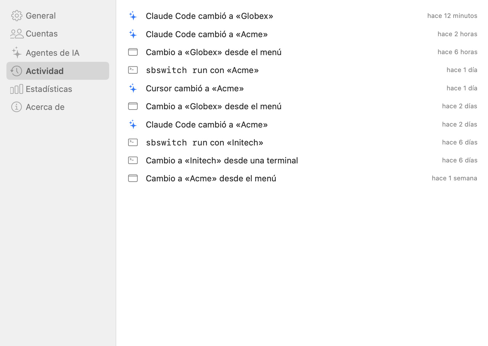

# Supabase Switch

**Cambia la cuenta con la que trabaja el CLI de Supabase: un clic en la barra de menús, sin navegador.**

[English](README.md)

 

El CLI `supabase` guarda una sola sesión. Si tus proyectos viven en varias
cuentas de Supabase —una por cliente, la personal y la del trabajo—, cada cambio
es `supabase logout`, `supabase login`, una pestaña del navegador y un código.
Supabase Switch guarda un token de acceso por cuenta en el Llavero de macOS y le
da al CLI el que toca cuando haces clic.

- **Un clic** en la barra de menús, o `sbswitch use acme` en la terminal.
- **Tu agente de IA cambia por ti**: Claude Code, Codex, Cursor y cualquier
  otro cliente MCP pueden llamar a `use_project` antes de ejecutar `supabase`.
  Cada cambio queda registrado con quién lo pidió, y se puede apagar. Ver
  [Agentes de IA](#agentes-de-ia-mcp).
- **Los proyectos a mano**: cada cuenta lista sus proyectos; copias el `ref`
  para `--project-ref` o `supabase link` sin abrir el panel.
- **Tus nombres**: renombra las cuentas y pon alias locales a los proyectos
  (`acme-production` → «Acme prod»). Supabase nunca los ve.
- **Actividad y estadísticas**: cada cambio con quién lo hizo (tú en el menú,
  una terminal o qué agente), y las cuentas por cuenta, por origen y por
  agente. Solo en tu Mac.
- **Una orden suelta con otra cuenta** sin cambiar:
  `sbswitch run globex -- supabase migration list`.
- **Se entera de los logins hechos fuera**: un `supabase login` en una terminal
  aparece en el menú en 30 segundos como mucho.
- **Ventana de ajustes** (⌘, desde el menú): cuentas, agentes, actividad,
  estadísticas, idioma y «Acerca de».
- En inglés y en español, según el idioma del sistema o el que elijas.

## Requisitos

- macOS 13 Ventura o posterior, con Apple Silicon o Intel.
- El [CLI de Supabase](https://supabase.com/docs/guides/local-development/cli/getting-started)
  instalado con Homebrew o en el `PATH` del shell. Probado con la 2.114.
- Para compilar: Swift 5.9 o posterior; bastan las Command Line Tools
  (`xcode-select --install`).

## Instalar

```bash
git clone https://github.com/radafdez/supabase-switch.git
cd supabase-switch
./scripts/build-app.sh --install
```

Compila la app, la copia a `/Applications`, enlaza `sbswitch` junto al CLI de
Supabase y la abre. Aparece un rayo en la barra de menús.

Con Homebrew:

```bash
brew install --cask radafdez/tap/supabase-switch
```

Instala la app en `/Applications` y enlaza `sbswitch`. Al nombrar el tap
completo solo se confía en este cask, no en el resto del tap. La app **no está
notarizada**, así que la primera vez macOS la bloquea igual que la del zip:
ábrela una vez y pulsa **Abrir igualmente** en **Ajustes del Sistema →
Privacidad y seguridad**. Hazlo antes de usar `sbswitch`: hasta que la app se
abre una vez, macOS también para la orden. Después se actualiza sola, y `brew upgrade` no la
toca. Para quitarla, `brew uninstall --cask supabase-switch`; con `--zap` borra
también tu lista de cuentas y tus ajustes (los tokens siguen en el Llavero).

Las versiones publicadas en [Releases](https://github.com/radafdez/supabase-switch/releases)
**no están notarizadas** por Apple: la primera vez macOS la bloquea. Ábrela una
vez y pulsa **Abrir igualmente** en **Ajustes del Sistema → Privacidad y
seguridad**. Si prefieres no hacerlo, compílala: tarda un minuto.

Eso es solo la primera vez: desde la 1.3.0 la app se actualiza sola.

### Actualizaciones

Las copias descargadas de Releases se actualizan con [Sparkle](https://sparkle-project.org).
En el segundo arranque la app pregunta una vez si comprobar por su cuenta;
puedes cambiarlo, o comprobar a mano, en **Ajustes → General** y **Acerca de**.
Si encuentra una versión mientras trabajas, no abre ninguna ventana: el menú
muestra «La versión … está lista para instalar».

Cada actualización va firmada con la clave EdDSA del proyecto, y también el
feed que la anuncia. La app tiene la mitad pública y rechaza un feed o un zip
que no coincida, antes de descomprimir nada. Esa firma, y no una notarización
de Apple, es lo que prueba que una actualización sale de este repositorio. Una
actualización que instala Sparkle no queda en cuarentena, así que no hace falta
volver a pulsar **Abrir igualmente**.

Una copia instalada con Homebrew se actualiza igual. Una copia compilada desde
el código no se actualiza sola: haz pull y vuelve a compilar.

## Primeros pasos

1. Con el CLI logueado en una cuenta, «Capturar la sesión actual del CLI». macOS
   pide permiso para leer la entrada del CLI en el Llavero: con **Permitir**
   basta.
2. Para cada una de las otras cuentas, una de dos:
   - «Añadir cuenta con su token…», pegando un token creado en
     <https://supabase.com/dashboard/account/tokens> con esa cuenta.
   - `supabase login` con esa cuenta una última vez, y volver a capturar.
3. A partir de ahí, un clic.

Con clic derecho sobre una cuenta: renombrar, releer proyectos o quitarla. El
lápiz junto a un proyecto le pone un nombre local.

## Agentes de IA (MCP)

`sbswitch mcp` es un servidor del [Model Context Protocol](https://modelcontextprotocol.io)
por stdio. Un agente que está trabajando en una funcionalidad puede preguntar
en qué cuenta está el CLI y cambiarlo a la dueña del proyecto, sin que salgas
de la conversación.

| Herramienta | Qué hace |
|-------------|----------|
| `list_accounts` | Las cuentas y sus proyectos (ref, nombre, alias, región), y en cuál está el CLI. Solo lectura. |
| `current_account` | La cuenta con la que el CLI tiene sesión ahora. Solo lectura. |
| `use_project` | Pone el CLI en la cuenta dueña de un proyecto (ref, nombre o alias). No hace nada si ya está ahí. |
| `switch_account` | Cambia a una cuenta por su nombre. |

**Se conecta** desde **Ajustes → Agentes de IA**: un botón para Claude Code y
otro para Codex (ejecutan `claude mcp add` / `codex mcp add` por ti). O a mano:

```bash
claude mcp add --scope user supabase-switch -- "/Applications/Supabase Switch.app/Contents/MacOS/sbswitch" mcp
```

```bash
codex mcp add supabase-switch -- "/Applications/Supabase Switch.app/Contents/MacOS/sbswitch" mcp
```

Para Claude Desktop, Cursor, Windsurf y las demás que se configuran con JSON,
el mismo panel da el bloque para pegar (está en el
[README en inglés](README.md#ai-agents-mcp)).

Qué pueden hacer los agentes y qué no:

- **Nunca ven un token**: el servidor solo devuelve nombres, refs y regiones.
- Cada cambio que hacen queda registrado con el nombre del agente (tal como se
  llama a sí mismo su cliente MCP) y aparece en **Actividad**, con un aviso de
  macOS si lo quieres.
- **Ajustes → Agentes de IA → Dejar que los agentes de IA cambien la cuenta**
  lo apaga. Siguen pudiendo ver qué cuenta está en uso, y reciben un error que
  les dice que te lo pidan.
- El servidor solo cambia la sesión del CLI. No ejecuta órdenes `supabase`, no
  lee los datos de tus proyectos ni toca tu base de datos.



## `sbswitch`

Las órdenes son las mismas que en el [README en inglés](README.md#sbswitch);
`sbswitch help` las explica en el idioma del sistema.

## Seguridad y privacidad

- Los tokens solo están en el Llavero de macOS: nunca en un fichero, nunca en
  los argumentos de un proceso.
- `~/Library/Application Support/SupabaseSwitch/accounts.json` guarda nombres,
  refs, regiones, tus alias y el historial de uso (cuenta, tipo y hora; nunca la
  orden). Nada secreto.
- **Sin telemetría.** De tu Mac no sale nada más que lo que el propio CLI le
  envía a Supabase. Buscar actualizaciones (solo si lo permites, o si pulsas el
  botón) pide a GitHub `appcast.xml`, la lista de versiones; no envía ningún
  perfil de tu Mac.
- Cualquier proceso con tu usuario puede leer los tokens a través de `security`
  sin que macOS pregunte, igual que la sesión del propio CLI.
- Un agente con el MCP conectado puede cambiar el CLI a cualquier cuenta
  registrada. Si prefieres hacerlo tú, apágalo en Ajustes.

Para informar de una vulnerabilidad, ver [SECURITY.md](SECURITY.md).

## Licencia

[MIT](LICENSE). La app incluye [Sparkle](https://github.com/sparkle-project/Sparkle),
© sus autores, con licencia MIT; su aviso va dentro de la app, en
`Contents/Resources/Sparkle-LICENSE.txt`.

---

Supabase Switch es un proyecto independiente, sin relación con Supabase Inc. ni
respaldado por ella. Supabase es una marca de Supabase Inc. La app no usa el
logo de Supabase.
