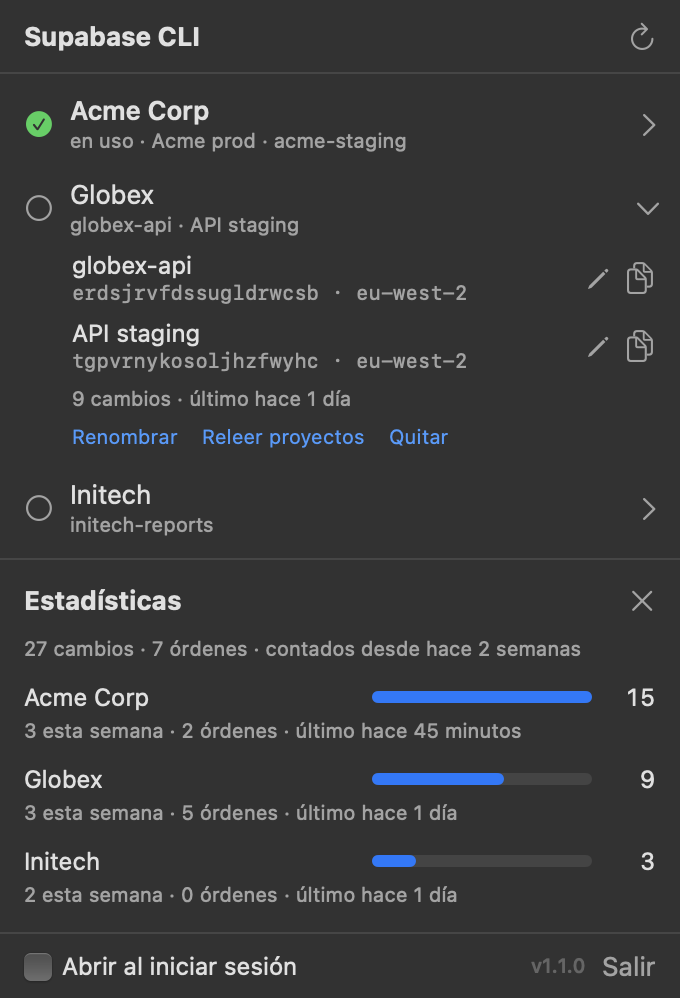

# Supabase Switch

**Cambia la cuenta con la que trabaja el CLI de Supabase: un clic en la barra de menús, sin navegador.**

[English](README.md)



El CLI `supabase` guarda una sola sesión. Si tus proyectos viven en varias
cuentas de Supabase —una por cliente, la personal y la del trabajo—, cada cambio
es `supabase logout`, `supabase login`, una pestaña del navegador y un código.
Supabase Switch guarda un token de acceso por cuenta en el Llavero de macOS y le
da al CLI el que toca cuando haces clic.

- **Un clic** en la barra de menús, o `sbswitch use acme` en la terminal.
- **Los proyectos a mano**: cada cuenta lista sus proyectos; copias el `ref`
  para `--project-ref` o `supabase link` sin abrir el panel.
- **Tus nombres**: renombra las cuentas y pon alias locales a los proyectos
  (`acme-production` → «Acme prod»). Supabase nunca los ve.
- **Estadísticas básicas**: cambios y órdenes `sbswitch run` por cuenta, de esta
  semana y cuándo se usó cada una por última vez. Solo en tu Mac.
- **Una orden suelta con otra cuenta** sin cambiar:
  `sbswitch run globex -- supabase migration list`.
- **Se entera de los logins hechos fuera**: un `supabase login` en una terminal
  aparece en el menú en 30 segundos como mucho.
- En inglés y en español, según el idioma del sistema.

## Requisitos

- macOS 13 Ventura o posterior, con Apple Silicon o Intel.
- El [CLI de Supabase](https://supabase.com/docs/guides/local-development/cli/getting-started)
  instalado con Homebrew o en el `PATH` del shell. Probado con la 2.114.
- Para compilar: Swift 5.9 o posterior; bastan las Command Line Tools
  (`xcode-select --install`).

## Instalar

```bash
git clone https://github.com/radafdez/supabase-switch.git
cd supabase-switch
./scripts/build-app.sh --install
```

Compila la app, la copia a `/Applications`, enlaza `sbswitch` junto al CLI de
Supabase y la abre. Aparece un rayo en la barra de menús.

Las versiones publicadas en [Releases](https://github.com/radafdez/supabase-switch/releases)
**no están notarizadas** por Apple: la primera vez macOS la bloquea. Ábrela una
vez y pulsa **Abrir igualmente** en **Ajustes del Sistema → Privacidad y
seguridad**. Si prefieres no hacerlo, compílala: tarda un minuto.

## Primeros pasos

1. Con el CLI logueado en una cuenta, «Capturar la sesión actual del CLI». macOS
   pide permiso para leer la entrada del CLI en el Llavero: con **Permitir**
   basta.
2. Para cada una de las otras cuentas, una de dos:
   - «Añadir cuenta con su token…», pegando un token creado en
     <https://supabase.com/dashboard/account/tokens> con esa cuenta.
   - `supabase login` con esa cuenta una última vez, y volver a capturar.
3. A partir de ahí, un clic.

Con clic derecho sobre una cuenta: renombrar, releer proyectos o quitarla. El
lápiz junto a un proyecto le pone un nombre local.

## `sbswitch`

Las órdenes son las mismas que en el [README en inglés](README.md#sbswitch);
`sbswitch help` las explica en el idioma del sistema.

## Seguridad y privacidad

- Los tokens solo están en el Llavero de macOS: nunca en un fichero, nunca en
  los argumentos de un proceso.
- `~/Library/Application Support/SupabaseSwitch/accounts.json` guarda nombres,
  refs, regiones, tus alias y el historial de uso (cuenta, tipo y hora; nunca la
  orden). Nada secreto.
- **Sin telemetría.** De tu Mac no sale nada más que lo que el propio CLI le
  envía a Supabase.
- Cualquier proceso con tu usuario puede leer los tokens a través de `security`
  sin que macOS pregunte, igual que la sesión del propio CLI.

Para informar de una vulnerabilidad, ver [SECURITY.md](SECURITY.md).

## Licencia

[MIT](LICENSE)

---

Supabase Switch es un proyecto independiente, sin relación con Supabase Inc. ni
respaldado por ella. Supabase es una marca de Supabase Inc. La app no usa el
logo de Supabase.
