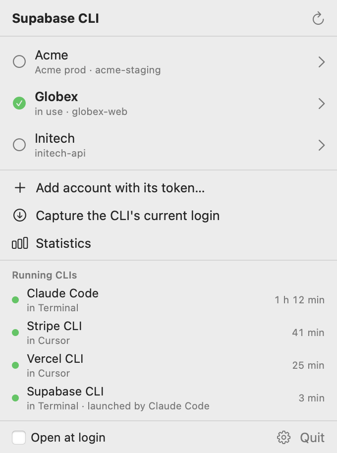
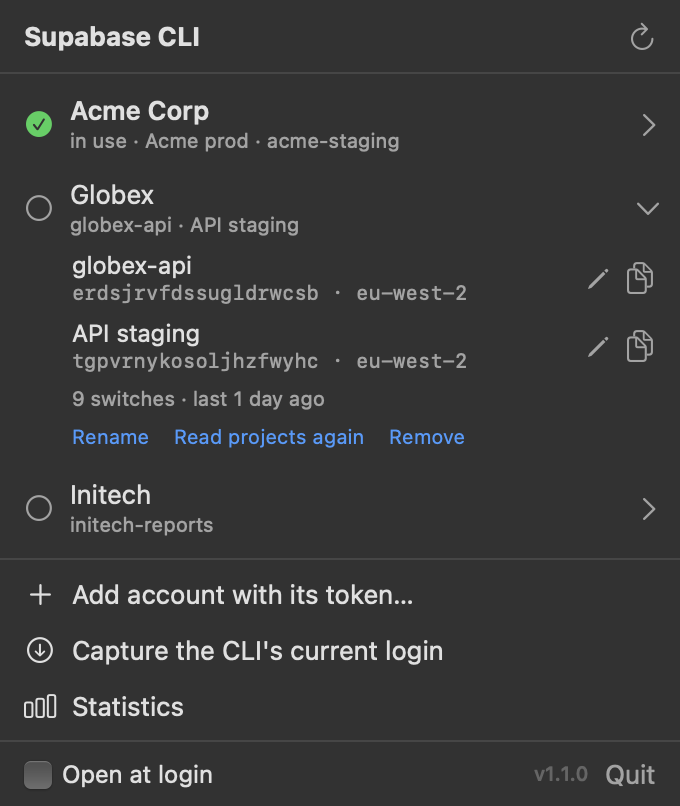

# Supabase Switch

**Switch the account the Supabase CLI is logged in as — one click in the menu bar, no browser.**

[Español](README.es.md)

 

The `supabase` CLI keeps a single login. If your projects live in several
Supabase accounts — one per client, personal and work, a shared org — every
change means `supabase logout`, `supabase login`, a browser tab and a code.
Supabase Switch keeps one access token per account in the macOS Keychain and
hands the right one to the CLI when you click.

- **One click** in the menu bar, or `sbswitch use acme` in a terminal.
- **Projects at hand**: each account lists its projects; copy a `ref` for
  `--project-ref` or `supabase link` without opening the dashboard.
- **Your names**: rename accounts, and give projects local aliases
  (`acme-production` → “Acme prod”). Supabase never sees them.
- **Basic statistics**: switches and `sbswitch run` commands per account,
  this week, and when each was last used. Kept on your Mac only.
- **One-off commands as another account** without switching:
  `sbswitch run globex -- supabase migration list`.
- **Notices logins made elsewhere**: a `supabase login` typed in a terminal
  shows up in the menu within 30 seconds.
- English and Spanish, following the system language.

## Requirements

- macOS 13 Ventura or later, on Apple Silicon or Intel.
- The [Supabase CLI](https://supabase.com/docs/guides/local-development/cli/getting-started)
  installed with Homebrew (`/opt/homebrew/bin` or `/usr/local/bin`) or anywhere
  on your login shell's `PATH`. Tested with CLI 2.114.
- To build: Swift 5.9 or later — the Xcode Command Line Tools are enough
  (`xcode-select --install`); Xcode works too.

## Install

### From source (recommended)

```bash
git clone https://github.com/radafdez/supabase-switch.git
cd supabase-switch
./scripts/build-app.sh --install
```

That builds the app, copies it to `/Applications`, links `sbswitch` next to
the Supabase CLI and opens it. A bolt appears in the menu bar.

### From a release

Download `Supabase-Switch-<version>.zip` from
[Releases](https://github.com/radafdez/supabase-switch/releases), unzip it and
move the app to `/Applications`. Release builds are **not notarized** by
Apple, so the first launch is blocked: open it once, then go to
**System Settings → Privacy & Security** and click **Open Anyway**. If you
would rather not do that, build from source — it takes about a minute.

## First steps

1. With the CLI logged in to one account, open the menu and choose
   **Capture the CLI's current login**. macOS asks for permission to read the
   CLI's Keychain entry: **Allow** is enough, “Always Allow” is not needed.
2. For each other account, either:
   - choose **Add account with its token…** and paste an access token created
     at <https://supabase.com/dashboard/account/tokens> while signed in to
     that account, or
   - run `supabase login` with that account one last time, then capture again.
3. From then on, click an account to switch.

Right-click an account to rename it, read its projects again or remove it. The
pencil next to a project gives it a local name.

## `sbswitch`

```text
sbswitch                          list the accounts and mark the one in use
sbswitch use <account>            switch the CLI to that account
sbswitch current                  say which account the CLI is on now
sbswitch capture [name]           register the account the CLI is logged in as
sbswitch add [name]               register an account from its access token
sbswitch refresh [account]        read the projects again
sbswitch rename <account> <new name>
sbswitch alias <project> [alias]  give a project a local name (none = back to Supabase's)
sbswitch remove <account>
sbswitch stats                    switches and runs per account
sbswitch run <account> -- <cmd>   run one command as that account without switching
sbswitch version
```

`<account>` is its name, the start of its name, or the ref, name or alias of
one of its projects. `sbswitch add` reads the token without echo, or from
standard input — never from the arguments, where other processes could see it:

```bash
pbpaste | sbswitch add "Globex"
```

## How it works

- **Switching** pipes the stored token into `supabase login`: the CLI's own
  login path, minus the browser. The token is tried on its own first, so a
  revoked one never replaces a login that works; afterwards the CLI is asked
  who it is, and only then is the switch reported as done.
- **Telling accounts apart**: an account is the set of organizations it can see
  (`supabase orgs list`). The app never calls the Supabase API itself — every
  request goes through the CLI.
- **Knowing who is logged in, cheaply**: the app reads only the modification
  date of the CLI's Keychain entry (no prompt) and asks the CLI only when that
  date changes.
- `supabase logout` wipes everything under the Keychain service “Supabase CLI”,
  so this app keeps its tokens under its own service, “Supabase Switch”, and
  they survive a logout.

```text
Sources/SwitchCore       logic without UI: accounts, Keychain, CLI, usage
Sources/SupabaseSwitch   the menu bar app (SwiftUI)
Sources/sbswitch         the same logic from a terminal
Tests/SwitchCoreTests    tests with a fake Keychain and a fake CLI
```

## Security and privacy

- Access tokens live **only in the macOS login Keychain**. They are never
  written to a file and never passed as process arguments (stdin or the
  environment only).
- `~/Library/Application Support/SupabaseSwitch/accounts.json` holds account
  names, project refs, regions, your aliases and the usage history (account,
  kind and time — never the command). Nothing secret. Mode `0600`.
- **No telemetry.** Nothing leaves your Mac except what the Supabase CLI itself
  sends to Supabase.
- Worth knowing:
  - Each registered account means one long-lived access token in the Keychain.
    Any process running as your user can read entries created through
    `/usr/bin/security` without a prompt — the same exposure the CLI's own
    login has.
  - `sbswitch run` puts the token in the environment of the command it runs.
  - If you revoke a token in the dashboard, that account stops switching: add
    it again.
- Not handled: the CLI's fallback token file `~/.supabase/access-token`, used
  when no Keychain is available.

See [SECURITY.md](SECURITY.md) to report a vulnerability.

## Development

```bash
./scripts/test.sh          # unit tests
./scripts/build-app.sh     # dist/Supabase Switch.app and dist/sbswitch
open "dist/Supabase Switch.app"
```

Two quirks of building with only the Command Line Tools are handled in the code:

- **Tests** use Swift Testing, whose macro plugin the compiler does not find on
  its own there; `scripts/test.sh` passes its path. With Xcode, plain
  `swift test` works too.
- **`@State` and `@FocusState`** are macros in the macOS 27 SDK and their plugin
  ships only with Xcode. Views use the aliases `@ViewState` and `@ViewFocus`
  from `Sources/SupabaseSwitch/ViewState.swift` instead.

`libSwiftScan` and `search path … not found` warnings are harmless.

User-facing text goes through `tr("English", "Español")` (in
`Sources/SwitchCore/Localization.swift`). `SUPABASE_SWITCH_LANG=en|es` forces a
language.

Contributions are welcome — see [CONTRIBUTING.md](CONTRIBUTING.md).

## License

[MIT](LICENSE)

---

Supabase Switch is an independent project, not affiliated with or endorsed by
Supabase Inc. Supabase is a trademark of Supabase Inc. The app does not use the
Supabase logo.
